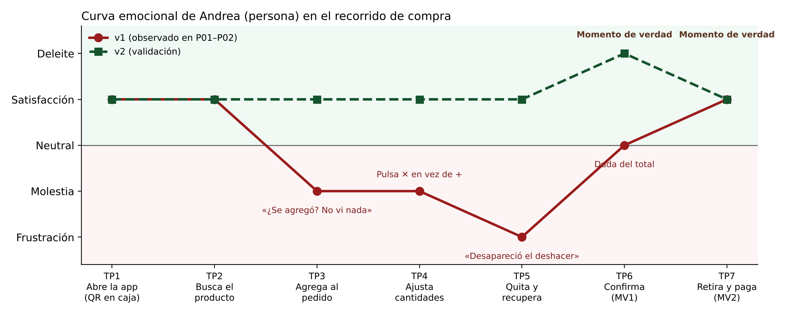

# Análisis de usuario y experiencia · CaféU 2.0

## 1. Persona usuaria

| | |
|---|---|
| **Nombre (ficticio)** | Andrea, 20 años |
| **Perfil** | Estudiante de 4.º semestre de la FISEI; compra en la cafetería 3–4 veces por semana. |
| **Dispositivo** | Celular Android de gama media; a veces usa la laptop del laboratorio. |
| **Objetivo** | Tener su pedido correcto y listo al salir de clase, sin hacer fila. |
| **Frustraciones** | Filas en el receso de 15 min; no saber si su pedido «se envió»; equivocarse de cantidad; borrar algo sin querer y no poder recuperarlo. |
| **Habilidad digital** | Media-alta: usa apps de comida y banca, pero lee rápido y con una mano. |
| **Cita** | «Si no veo que se agregó, lo vuelvo a tocar… y termino con dos.» |

## 2. Contexto de interacción

| Dimensión | Descripción |
|---|---|
| **Dónde** | Pasillos y aulas de la FISEI, de pie o caminando; luz solar en patios. |
| **Cuándo** | Recesos de 10–15 min; picos a las 09:30 y 12:30. |
| **Cómo** | Una mano, pulgar; atención dividida (conversación, notificaciones). |
| **Restricciones** | Wi-Fi del campus intermitente; tiempo corto; pantalla pequeña (360–412 px). |
| **Implicaciones de diseño** | Mobile First, objetivos táctiles ≥ 44 px, mensajes visibles junto a la acción, persistencia local del pedido, recuperación sin penalización. |

## 3. Touchpoints y momentos de verdad

| ID | Touchpoint | Canal | Emoción v1 | Momento crítico |
|---|---|---|---|---|
| TP1 | Ve el QR/cartel en la caja y abre la app | Físico → web | Satisfacción | |
| TP2 | Busca el producto (escribe sin tildes) | App · Catálogo | Satisfacción | |
| TP3 | Agrega al pedido | App · Catálogo | Molestia: «¿se agregó?» | |
| TP4 | Ajusta cantidades | App · Mi pedido | Molestia: pulsa ✕ en vez de + | |
| TP5 | Quita y recupera un producto | App · Mi pedido | **Frustración**: el «Deshacer» desaparece | Momento crítico |
| TP6 | Confirma y recibe el número | App · Confirmación | Neutral: duda del total | **Momento de verdad 1** |
| TP7 | Retira y paga en caja | Físico | Satisfacción | **Momento de verdad 2** |

- **MV1 · Confirmar el pedido:** si el número, el detalle o el total no son claros, Andrea no confía en la app y vuelve a la fila.
- **MV2 · Retirar en caja:** si el pedido no coincide con lo que pidió (p. ej. falta el sánduche que «recuperó»), la confianza se pierde de forma definitiva.

## 4. Curva emocional

La v1 cae en TP3–TP5 por la poca visibilidad de los mensajes y la eliminación accidental sin recuperación efectiva; la v2 mantiene una experiencia positiva y sube en el MV1 al mostrar el total en el botón de confirmación.

## 5. Matriz de problemas (Nielsen y Gestalt)

| ID | Problema observado | Evidencia | Heurística de Nielsen | Principio Gestalt | Severidad (0–4) |
|---|---|---|---|---|---|
| PX-01 | El aviso de «Agregado» es pequeño, gris y aparece en la esquina inferior, lejos del botón. | P01 en T1: «¿se agregó? no vi nada». Contraste 3,14:1. | H1 Visibilidad del estado del sistema | **Proximidad:** el mensaje está lejos de la acción que lo produce. | 3 |
| PX-02 | El botón ✕ para quitar está junto a + y tiene la misma forma y tamaño. | P02 en T2 pulsó ✕ en lugar de +. | H5 Prevención de errores · H4 Consistencia | **Semejanza:** − + ✕ se perciben como un mismo grupo de controles de cantidad. | 3 |
| PX-03 | «Deshacer» solo existe 2,5 s dentro del aviso. | P01 y P02 en T3 no alcanzaron a usarlo. | H3 Control y libertad · H9 Recuperarse de errores | **Figura-fondo:** el aviso gris se confunde con el fondo. | 4 |
| PX-04 | Al escribir 0 o 15 en la cantidad aparece «Cantidad inválida» sin explicar el límite. | Inspección heurística. | H9 Recuperarse de errores · H5 | **Región común:** el error no está dentro de la tarjeta del producto afectado. | 2 |
| PX-05 | La búsqueda sin resultados solo dice «Sin resultados.». | Inspección heurística. | H9 · H10 Ayuda | **Continuidad:** el flujo se corta sin salida visible. | 2 |
| PX-06 | El botón «Confirmar pedido» no muestra el total. | P01 en T3 volvió a desplazarse para revisar el total. | H6 Reconocer antes que recordar · H1 | **Proximidad:** total y acción final separados. | 1 |

La severidad y la triangulación con los usuarios se consolidan en [`evaluacion/hallazgos.md`](../evaluacion/hallazgos.md).
