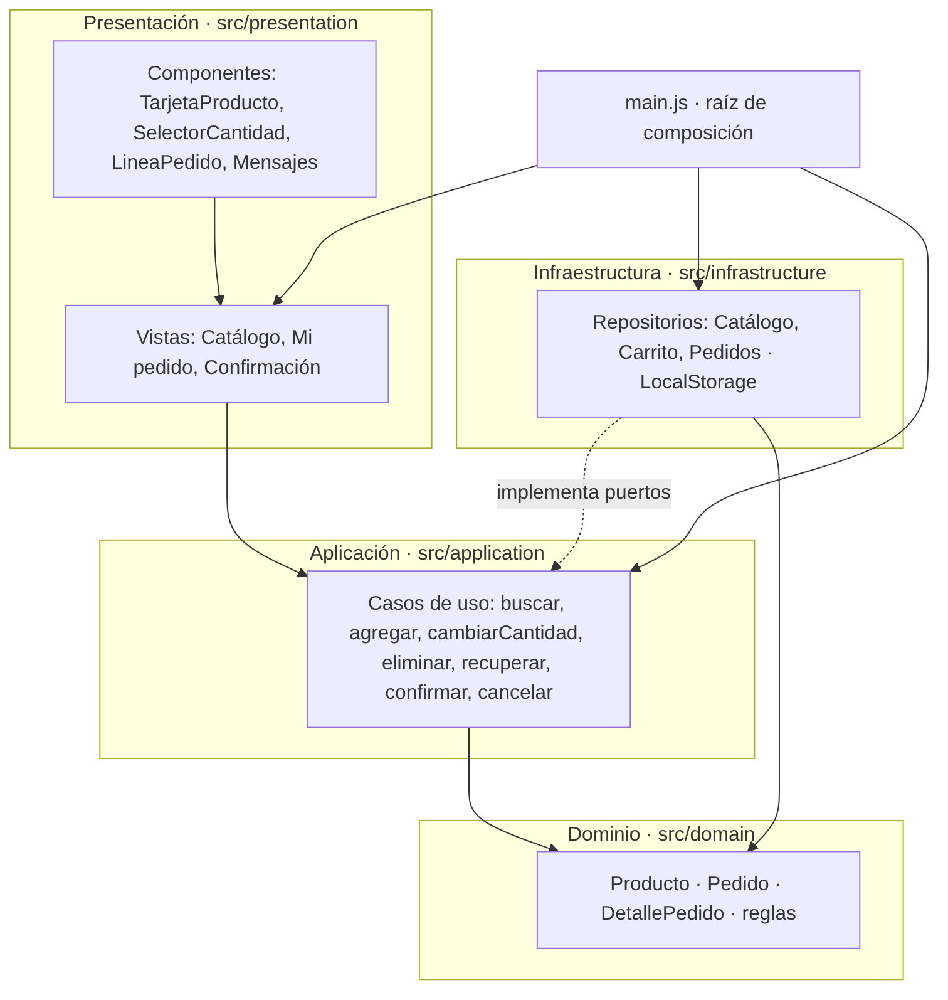

# Arquitectura de software · CaféU 2.0

Aplicación web estática en **HTML, CSS y JavaScript con módulos ES**, sin frameworks ni dependencias en tiempo de ejecución, organizada en cuatro capas.

## 1. Capas y responsabilidades

| Capa | Carpeta | Contenido | Depende de |
|---|---|---|---|
| **Presentación** | `src/presentation/` | `app.js` (rutas por hash y acciones), vistas (`VistaCatalogo`, `VistaPedido`, `VistaConfirmacion`) y componentes reutilizables (`TarjetaProducto`, `SelectorCantidad`, `LineaPedido`, `Mensajes`, `dom.h`). Accesibilidad: HTML semántico, foco gestionado, `aria-live`, `aria-invalid`. | Aplicación (casos de uso) y, solo para formatear y leer límites, `domain/reglas.js` |
| **Aplicación** | `src/application/casosDeUso.js` | Casos de uso: `buscarProductos`, `agregarAlCarrito`, `cambiarCantidad`, `eliminarDelCarrito`, `recuperarEliminado`, `confirmarPedido`, `cancelarPedido`. Orquesta dominio y repositorios. | Dominio y **puertos** (repositorios recibidos por parámetro) |
| **Dominio** | `src/domain/` | `Producto`, `Pedido`, `DetallePedido` y `reglas.js` (normalización sin tildes, límites 1–10, plazo de cancelación de 5 min, formato de dinero, `ErrorDeDominio`). | Nada |
| **Infraestructura** | `src/infrastructure/` | `CatalogoRepositorioEnMemoria`, `CarritoRepositorioLocal`, `PedidoRepositorioLocal` sobre `localStorage`, y `AlmacenamientoEnMemoria` como respaldo y para pruebas. | Dominio (para reconstruir entidades) |
| **Composición** | `src/main.js` | Crea los repositorios, inyecta en los casos de uso e inicia la presentación. | Todas |

## 2. Regla de dependencias

- Las dependencias apuntan **hacia el dominio**: Presentación → Aplicación → Dominio ← Infraestructura.
- El **dominio no importa nada** del navegador ni de otras capas; por eso las pruebas se ejecutan en Node sin DOM.
- La **aplicación no conoce `localStorage`**: recibe repositorios con la interfaz `obtener/guardar/vaciar` (carrito) y `siguienteNumero/guardar/porNumero/ultimo` (pedidos). Cambiar a una API REST solo exige otro repositorio con la misma interfaz en `infrastructure/` y un cambio en `main.js`.
- La presentación usa de `domain/reglas.js` únicamente funciones puras de formato y constantes (límites); toda modificación del estado pasa por los casos de uso.

## 3. Flujo de una acción (T2: cambiar cantidad)

1. `SelectorCantidad` (presentación) captura el clic en + y llama a `acciones.cambiarCantidad(id, 3)`.
2. `app.js` invoca el caso de uso `cambiarCantidad`.
3. El caso de uso obtiene el `Pedido` del repositorio, llama a `pedido.cambiarCantidad()` y lo guarda.
4. `Pedido`/`DetallePedido` validan la regla 1–10; si falla, lanzan `ErrorDeDominio` con un mensaje comprensible.
5. La presentación repinta la vista o muestra el error junto al campo (`aria-invalid`) y en la región de mensajes.

## 4. Decisiones de diseño de interacción en el código

| Decisión | Dónde | Motivo |
|---|---|---|
| Mobile First con `min-width` | `styles/main.css` | La persona usa el celular con una mano. |
| Objetivos de 44 px y foco de 3 px | `--toque`, `:focus-visible` | WCAG 2.5.5 y 2.4.7. |
| Mensajes en región `role="status"` bajo la cabecera | `Mensajes.js` | Visibilidad y anuncio a lectores de pantalla. |
| «Deshacer» persistente en el lugar de la línea | `LineaEliminada`, `app.js` | Control y libertad; recuperación sin límite de tiempo. |
| Creación de DOM sin `innerHTML` | `components/dom.js` | Evita inyección de HTML. |
| Parámetro `?reiniciar=1` | `main.js` | Estado inicial idéntico en cada sesión de evaluación. |

## 5. Pruebas

`npm test` ejecuta 12 pruebas con `node:test` sobre aplicación + dominio + infraestructura en memoria (ver [`tests/pruebas-automatizadas/`](../tests/pruebas-automatizadas/)). Cubren las tres tareas críticas: búsqueda tolerante (T1), cantidades y total (T2), eliminar/recuperar/confirmar/cancelar (T3), además de la persistencia.
