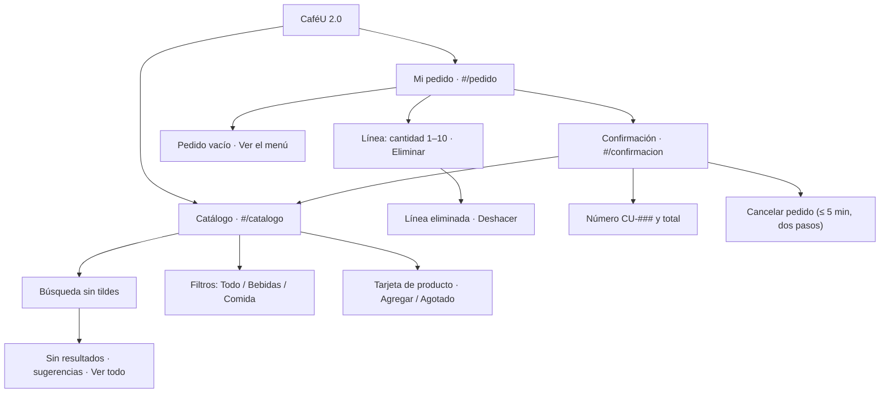

# Sitemap · CaféU 2.0

Aplicación de una sola página con tres pantallas (rutas por hash) y sus estados.

| Pantalla | Ruta | Estados | Wireframe |
|---|---|---|---|
| Catálogo | `#/catalogo` | Con resultados · sin resultados · producto agotado | [WF-01](../prototipos/wireframes/wf-01-catalogo.png) |
| Mi pedido | `#/pedido` | Con productos · error de cantidad · línea eliminada con «Deshacer» · vacío | [WF-02](../prototipos/wireframes/wf-02-mi-pedido.png) |
| Confirmación | `#/confirmacion` | Confirmado · pregunta de cancelación · cancelado | [WF-03](../prototipos/wireframes/wf-03-confirmacion.png) |

Navegación global: cabecera con «Catálogo» y «Mi pedido (n)», enlace «Saltar al contenido» y región de mensajes `role="status"`.
