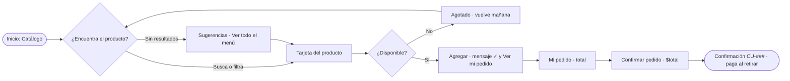
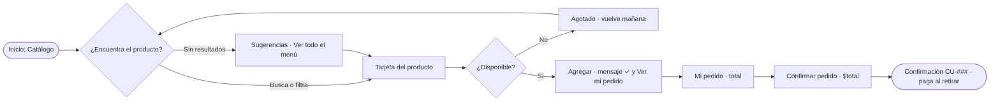
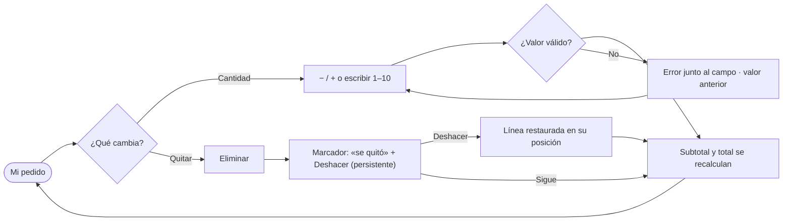
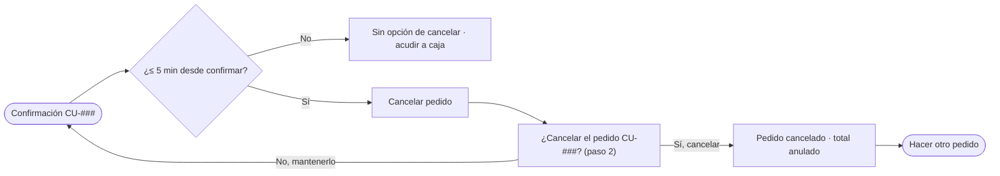

# User flows · compra, modificación y cancelación

## 1. Compra (T1 y T3)

## 2. Modificación del pedido (T2 y T3)

## 3. Cancelación

**Puntos de recuperación de errores:** sugerencias y «Ver todo el menú» cuando no hay resultados; error junto al campo cuando la cantidad no es válida; «Deshacer» persistente al eliminar; confirmación en dos pasos para cancelar.
