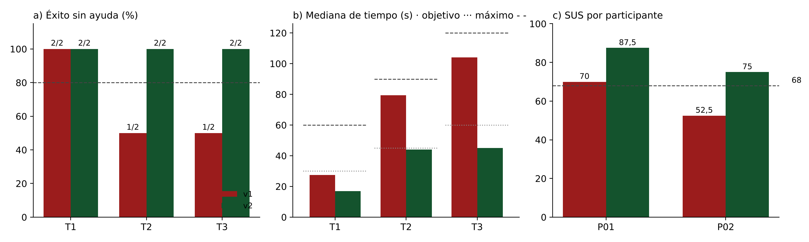

# Métricas de usabilidad · v1 y v2 (ISO 9241-11)

> **Nota metodológica.** Las sesiones P00, P01 y P02 (v1) y la reevaluación de la v2 corresponden a un ejercicio académico con participantes simulados, construidos a partir de la persona y el contexto de docs/analisis-ux.md.

Fuente: [`resultados.csv`](resultados.csv). Con n = 2 la «mediana» equivale al promedio de los dos tiempos; las métricas son **descriptivas**.

## 1. v1 · P01 y P02 (24/11/2026)

| Tarea | Éxito sin ayuda | Con ayuda | Mediana (s) | Tiempos (s) | Objetivo / máx. | E. críticos | E. no críticos | SEQ medio |
|---|---|---|---|---|---|---|---|---|
| T1 · Buscar y agregar | 2/2 (100 %) | 0 | 27,5 | 24, 31 | 30 / 60 | 0 | 0 | 5,5 |
| T2 · Modificar cantidad y verificar total | 1/2 (50 %) | 1 | 79,5 | 58, 101 | 45 / 90 | 0 | 2 | 4 |
| T3 · Eliminar, recuperar y confirmar | 1/2 (50 %) | 0 | 104 | 112, 96 | 60 / 120 | 1 | 1 | 2,5 |
| **Total** | **4/6 (66,7 %)** | 1 | | | | **1** | **3** | |

| Participante | SUS v1 |
|---|---|
| P01 | 70 |
| P02 | 52,5 |
| **Media** | **61,25** (bajo 68) |

## 2. v2 · repetición con P01 y P02 (25/11/2026)

| Tarea | Éxito sin ayuda | Mediana (s) | Tiempos (s) | E. críticos | E. no críticos | SEQ medio |
|---|---|---|---|---|---|---|
| T1 · Buscar y agregar | 2/2 (100 %) | 17 | 15, 19 | 0 | 0 | 6,5 |
| T2 · Modificar cantidad y verificar total | 2/2 (100 %) | 44 | 41, 47 | 0 | 0 | 6 |
| T3 · Eliminar, recuperar y confirmar | 2/2 (100 %) | 45 | 38, 52 | 0 | 0 | 6,5 |
| **Total** | **6/6 (100 %)** | | | **0** | **0** | |

| Participante | SUS v2 |
|---|---|
| P01 | 87,5 |
| P02 | 75 |
| **Media** | **81,25** (sobre 68) |

## 3. Comparación

| Dimensión | v1 | v2 | Cambio |
|---|---|---|---|
| Eficacia: éxito sin ayuda | 4/6 (66,7 %) | 6/6 (100 %) | +33,3 puntos |
| Eficacia: errores críticos / no críticos | 1 / 3 | 0 / 0 | −4 errores |
| Eficiencia: mediana T2 | 79,5 s | 44 s | −35,5 s |
| Eficiencia: mediana T3 | 104 s | 45 s | −59 s |
| Satisfacción: SUS medio | 61,25 | 81,25 | +20,00 |
| Satisfacción: SEQ T3 | 2,5 | 6,5 | +4 |

**Limitaciones:** muestra de dos participantes; en la v2 los mismos participantes repitieron las tareas, por lo que parte de la mejora puede deberse al aprendizaje. Por eso la validación se apoya también en la reverificación heurística, el recorrido cognitivo, la revisión de accesibilidad y las pruebas automatizadas ([`validacion-v2.md`](validacion-v2.md)).
