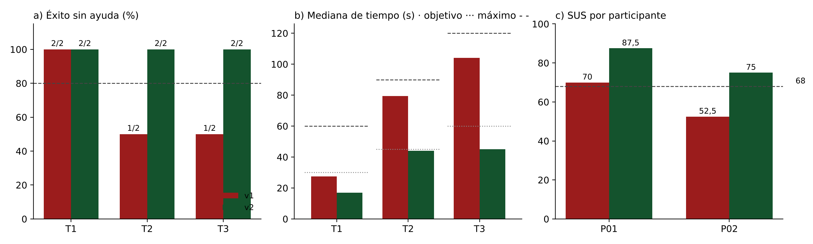

# Validación de la v2 · corrección, comparación y reevaluación

## 1. Cambios v1 → v2

| Backlog | Problema (v1) | Corrección (v2) | Archivos | Evidencia |
|---|---|---|---|---|
| B-01 | «Deshacer» dura 2,5 s en un aviso | Marcador persistente con «Deshacer» en la misma posición y foco en el botón | `presentation/components/LineaPedido.js`, `presentation/app.js`, `presentation/views/VistaPedido.js` | [antes/después](../evidencias/comparativas/05-recuperacion-tras-espera.png) |
| B-02 | ✕ pegado a + (28 px) | «Eliminar» con texto en otra fila; − / + de 44 px | `LineaPedido.js`, `SelectorCantidad.js`, `styles/main.css` | [antes/después](../evidencias/comparativas/04-eliminar.png) |
| B-03 | Aviso gris de 12 px (3,14:1) | Región de mensajes bajo la cabecera (7,97:1), cerrar, «✓ Agregado» y «Ver mi pedido» | `Mensajes.js`, `app.js`, CSS | [antes/después](../evidencias/comparativas/01-mensaje-al-agregar.png) |
| B-04 | «Cantidad inválida» | Error junto al campo con el rango y `aria-invalid` | `SelectorCantidad.js`, `app.js` | [antes/después](../evidencias/comparativas/03-error-de-cantidad.png) |
| B-05 | «Sin resultados.» | Sugerencias y «Ver todo el menú» | `views/VistaCatalogo.js` | [antes](../evidencias/antes/02-busqueda-sin-resultados.png) · [después](../evidencias/despues/02-busqueda-sin-resultados.png) |
| B-06, B-07 | Total oculto; sin acceso a «Mi pedido» | «Confirmar pedido · $7,25», «3 × $1,50 = $4,50», enlace en el mensaje | `VistaPedido.js`, `LineaPedido.js`, `app.js` | [después](../evidencias/despues/06-confirmacion.png) |

El código de la v1 se conserva en [`prototipos/version-v1/`](../prototipos/version-v1/) y la v2 está en [`src/`](../src/); en el historial de Git, la corrección es un commit propio (`fix(ux): v2 …`).

## 2. Comprobaciones repetidas

| Comprobación | v1 | v2 | Resultado |
|---|---|---|---|
| Pruebas automatizadas (`npm test`) | 12/12 | 12/12 | Las correcciones de interfaz no alteran las reglas de negocio. |
| Reverificación heurística (HE-01 a HE-06) | 6 hallazgos (sev. 1–4) | 0 abiertos | Ver [`heuristicas.md`](heuristicas.md) § 3. |
| Recorrido cognitivo T2 y T3 | 2 pasos con Q2 = No / ◐ | Todos los pasos Sí | Ver [`recorrido-cognitivo.md`](recorrido-cognitivo.md). |
| Accesibilidad WCAG 2.1 | Incumple 1.4.3, 2.2.1, 3.3.1, 3.3.3 | Cumple | Ver [`accesibilidad.md`](accesibilidad.md). |
| Repetición de T1–T3 con P01 y P02 | 4/6 sin ayuda · SUS 61,25 | 6/6 sin ayuda · SUS 81,25 | Ver [`metricas.md`](metricas.md). |

## 3. Conclusiones

- **Eficacia:** el éxito sin ayuda pasó de 4/6 (66,7 %) a 6/6 (100 %) y los errores de 1 crítico + 3 no críticos a ninguno. La causa del error crítico (H-01) y de la tarea con ayuda (H-02) desapareció con B-01 y B-02.
- **Eficiencia:** las medianas de T2 y T3 bajaron de 79,5 s a 44 s y de 104 s a 45 s, y quedaron bajo los objetivos (45 s y 60 s); la recuperación ya no obliga a volver al catálogo.
- **Satisfacción:** el SUS medio subió de 61,25 (bajo la referencia de 68) a 81,25, y el SEQ de T3 de 2,5 a 6,5.

## 4. Limitaciones

- Muestra de dos participantes: los resultados son **descriptivos** y no se generalizan estadísticamente.
- En la v2 repitieron las mismas personas, por lo que parte de la mejora en tiempo puede deberse al aprendizaje; por eso la validación se triangula con inspección heurística, recorrido cognitivo, accesibilidad y pruebas automatizadas, que no dependen de ese efecto.
- La evaluación se hizo en laptop con Chrome; falta comprobar con lectores de pantalla (NVDA/TalkBack) y en celulares reales de gama baja.
